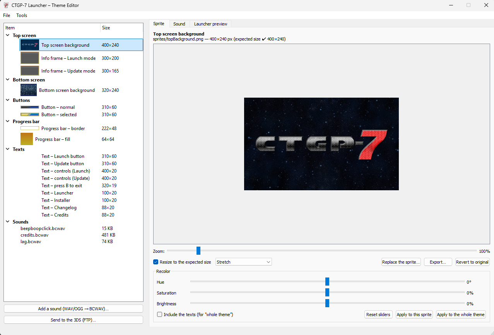
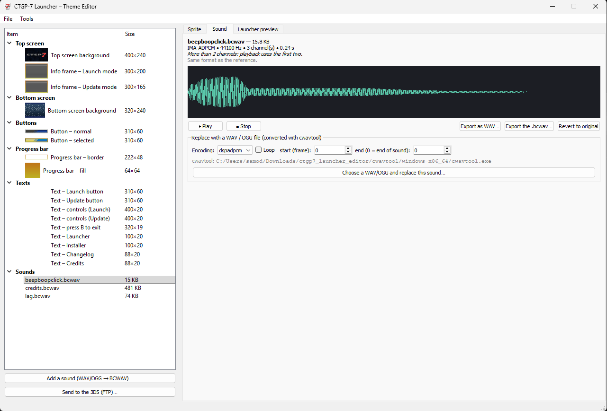
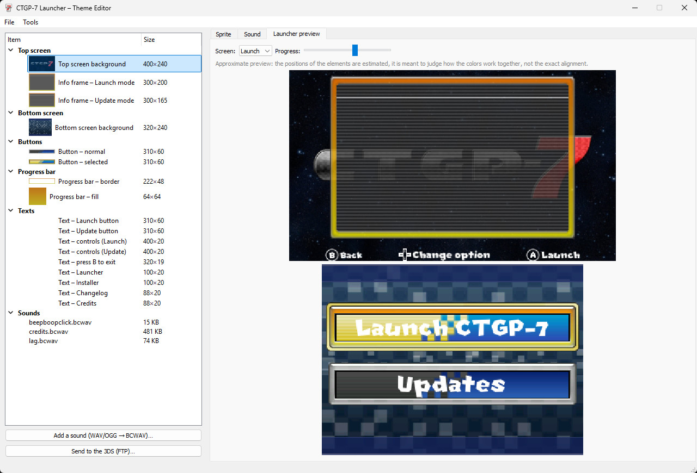
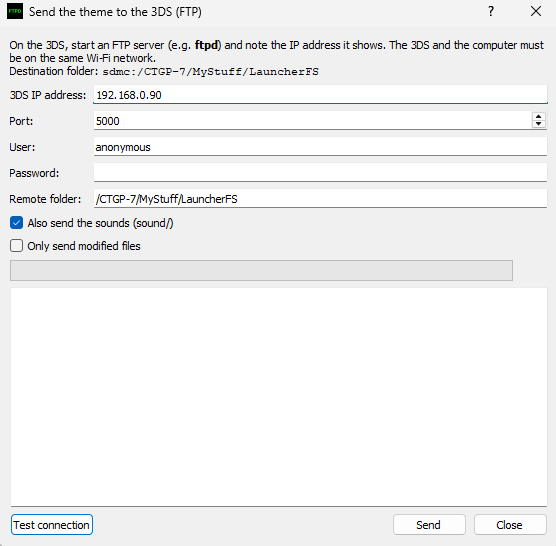

# CTGP-7 Theme Editor Launcher

A desktop tool to **create, preview and install custom themes** for the **CTGP-7 launcher** on Nintendo 3DS.
Edit every sprite and sound of the launcher, check the result live, and send your theme straight to your console over FTP.

| Platform      | Status          |
|---------------|-----------------|
| Windows 11/10 | ✅ Supported    |
| Linux         | ❌ Not Supported |
| MacOS         | ❌ Not Supported |
| Android       | ❌ Not Supported |

---

## 🚀 Getting started

1. Download the latest release and extract it.
2. Make sure the `cwavtool` folder is next to the editor (required for sound conversion).
3. Launch the editor.
4. Edit your sprites and sounds, check the **Launcher preview** tab.
5. Send the theme to your 3DS with **Send to the 3DS (FTP)...**.

---

## 🖥️ Interface

### Sprite tab

Select an item in the list on the left to edit it. All the launcher elements are listed with their expected size:

| Category      | Items |
|---------------|-------|
| Top screen    | Background (400×240), Info frame – Launch mode (300×200), Info frame – Update mode (300×165) |
| Bottom screen | Background (320×240) |
| Buttons       | Normal and selected (310×60) |
| Progress bar  | Border (222×48) and fill (64×64) |
| Texts         | Launch / Update buttons, controls, "press B to exit", Launcher, Installer, Changelog, Credits |
| Sounds        | `beepboopclick.bcwav`, `credits.bcwav`, `lag.bcwav` |

Available tools:

- **Zoom** to inspect the sprite
- **Resize to the expected size** (Stretch mode) so your image always fits
- **Replace the sprite**, **Export** it, or **Revert to original**
- **Recolor**: Hue, Saturation and Brightness sliders
  - *Apply to this sprite* or *Apply to the whole theme*
  - Optional *Include the texts* for a full-theme recolor

### Sound tab

- Shows the format info of the sound (codec, sample rate, channels, duration) and a waveform
- **Play / Stop** to listen to the sound
- **Export as WAV** or **Export the .bcwav**, or **Revert to original**
- **Replace with a WAV / OGG file** (converted with `cwavtool`):
  - Encoding (e.g. `dspadpcm`)
  - Loop option
  - Start and end frame
- **Add a sound (WAV/OGG → BCWAV)** button to add new sounds to your theme

### Launcher preview tab

- Switch between the **Launch** and **Update** screens
- Move the **Progress** slider to preview the progress bar
- ⚠️ The preview is approximate: element positions are estimated, it is meant to judge how the colors work together, not the exact alignment.

---

## 📡 Send your theme to the 3DS (FTP)

1. On your 3DS, start an FTP server (e.g. **ftpd**) and note the IP address it shows.
2. Make sure the 3DS and your computer are on the **same Wi-Fi network**.
3. In the editor, click **Send to the 3DS (FTP)...** and fill in:

| Field         | Default value |
|---------------|---------------|
| IP address    | The one shown by ftpd on your 3DS |
| Port          | `5000` |
| User          | `anonymous` |
| Password      | *(empty)* |
| Remote folder | `/CTGP-7/MyStuff/LauncherFS` |

4. Use **Test connection** to check everything works.
5. Options:
   - **Also send the sounds** (`sound/`)
   - **Only send modified files**
6. Click **Send**.

The theme is installed on the SD card in `sdmc:/CTGP-7/MyStuff/LauncherFS`.

---

## 📜 Credits
- ** Mininator **
- [`cwavtool`](https://github.com/) for the BCWAV conversion

> This project is a fan-made tool and is not affiliated with Nintendo or the CTGP-7 team.
